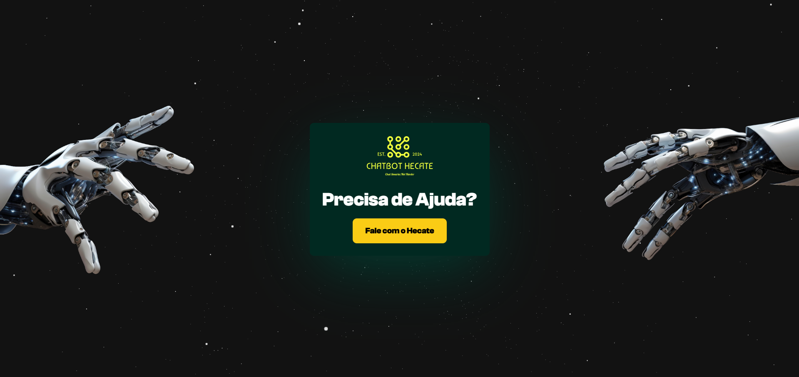

# Hecate Landing Page

<div align="center">
  
  
  
  

</div>



An animated, responsive marketing site for **Hecate**, an AI chatbot that businesses use as a first point of contact with their customers. This repository is the frontend landing page; the chatbot itself (Django + AI backend, React admin dashboard) lives in [hecate-chatbot](https://github.com/MatheusDSantossi/hecate-chatbot).

---

## What's here

- **Single-page site** with sections for the hero, "Why Hecate", a product carousel, an animated quote, features, contact and footer
- **Motion design** with Framer Motion: shared, standardized animation variants (`src/lib/animations.ts`), a typewriter-style text animation and a blinking cursor
- **Contact form** validated with react-hook-form + zod; submissions are sent from the browser through EmailJS
- **Responsive layouts** from mobile to desktop, with custom screen breakpoints
- **Render efficiency**: core components wrapped in `React.memo`
- **`backend/`**: a Django project scaffold (`startproject`), not yet connected to the frontend

---

## Tech stack

| Area | Tools (versions from `frontend/package.json`) |
|---|---|
| UI | React `^19.1.0`, TypeScript `~5.8.3` |
| Build | Vite `^6.3.5` |
| Styling | Tailwind CSS `^4.1.9` |
| Animation | Framer Motion `^12.19.1` |
| Carousel | Embla Carousel `^8.6.0` |
| Forms | react-hook-form `^7.60.0`, zod `^4.0.5`, @emailjs/browser `^4.4.1` |
| Tooling | ESLint `^9.25.0` with typescript-eslint and react-hooks rules |

---

## Quick start

Requires Node.js (tested with 22.16) and npm.

```bash
git clone https://github.com/MatheusDSantossi/hecate-landing-page.git
cd hecate-landing-page/frontend
npm ci
npm run dev        # http://localhost:5173
```

Other scripts: `npm run lint`, `npm run lint:fix`, `npm run build`, `npm run preview`.

> **Known issue:** `npm run build` currently fails type-checking (6 TypeScript errors). Tracked in [#9](https://github.com/MatheusDSantossi/hecate-landing-page/issues/9). The dev server is unaffected.

---

## Engineering practices

- **CI**: every pull request to `main` installs dependencies and runs ESLint (`.github/workflows/ci.yml`); the check is required by a branch ruleset
- **Attribution**: third-party components and inspirations are credited in [NOTICE.md](NOTICE.md)
- **Conventional commits** and feature branches merged through pull requests

---

## Project structure

```
hecate-landing-page/
├── backend/                 # Django project scaffold (not wired up yet)
├── frontend/
│   ├── public/              # images, logos, carousel slides
│   ├── src/
│   │   ├── components/      # page sections (navbar, carousel, contactUs, footer, ...)
│   │   ├── lib/             # shared Framer Motion animation variants
│   │   ├── styles/          # carousel styles
│   │   ├── utils/           # section content, nav data, zod contact schema
│   │   └── App.tsx
│   └── package.json
├── NOTICE.md
└── LICENSE
```

---

## License

Distributed under the MIT License. See [LICENSE](LICENSE) for details.
